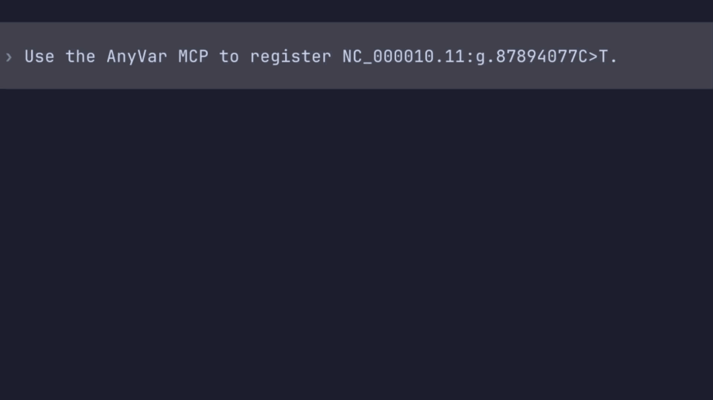

# AnyVar MCP Server

MCP server for [AnyVar](https://github.com/biocommons/anyvar).

See the [documentation](https://genomicmedlab.github.io/anyvar-mcp/) for setup and development instructions.

_Codex CLI using GPT-6-Luna at low reasoning effort_
